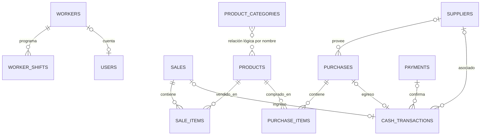

# Modelo actual de base de datos

**Fecha de inspección:** 6 de noviembre de 2026. **Alcance:** lectura del DDL/migraciones de `app/main.py` y `backend/db.js`, más inspección en modo solo lectura de `backend/database.db`. No se alteró ningún esquema ni registro.

## Bases encontradas y fuente vigente

El proyecto contiene dos aplicaciones y dos variantes del modelo:

- **FastAPI (aplicación principal):** `DATABASE_PATH`, por defecto `.local/dev-data/database.db` en desarrollo y `backend/database.db` en producción. Su esquema se define y evoluciona en `app/main.py`.
- **Express heredada:** fija `backend/database.db` y define el esquema en `backend/db.js`.
- El archivo presente `backend/database.db` coincide en buena parte con el modelo Express y además contiene columnas añadidas por migraciones de FastAPI (`users.worker_id`, `cash_transactions.payment_id`, entre otras). Por eso, la estructura de un archivo SQLite concreto puede variar según qué aplicación lo haya inicializado. El DDL de creación no representa por sí solo todas las migraciones aplicadas.

SQLite maneja los tipos declarados por afinidad; `REAL` no garantiza exactitud decimal. FastAPI habilita `PRAGMA foreign_keys=ON` en cada conexión (`app/database.py`). En el inicializador y la capa de conexión Express inspeccionados no aparece esa activación: aunque su DDL declare FKs, no se deben considerar aplicadas en esa superficie.

## Diagrama entidad-relación (FastAPI)

`cash_closures` es un resumen materializado sin FK al detalle que resume. `payments` puede existir como confirmación bancaria y el ingreso de caja puede enlazarla por `payment_id`; no existe una relación directa payment-sale. `gmail_config`, `payment_email_settings`, `parsers` y `audit_logs` son tablas de configuración/auditoría sin relaciones declaradas.

## Diccionario del modelo FastAPI

Convenciones: `PK` clave primaria, `FK` clave foránea, `UQ` única, `NN` no nulo. Los valores entre paréntesis son defaults.

| Tabla | Columnas |
|---|---|
| `users` | `id INTEGER PK`; `username TEXT NN UQ`; `password TEXT NN`; `role TEXT NN`; `name TEXT NN`; `cashierCode TEXT`; `document TEXT`; `phone TEXT`; `status TEXT` (`Activo`); `createdDate TEXT`; `worker_id INTEGER FK → workers.id` (añadido por migración; nullable, sin UQ). |
| `workers` | `id INTEGER PK`; `first_name TEXT NN`; `middle_name TEXT`; `last_name TEXT NN`; `second_last_name TEXT`; `identification_type TEXT NN`; `identification_number TEXT NN UQ`; `phone TEXT`; `photo TEXT`; `email TEXT`; `birth_date TEXT NN`; `contract_type TEXT NN`; `status TEXT NN` (`Activo`); `created_at TEXT NN`. |
| `worker_shifts` | `id INTEGER PK`; `worker_id INTEGER NN FK → workers.id ON DELETE CASCADE`; `shift_date TEXT NN`; `shift_type TEXT NN`; `UQ(worker_id, shift_date)`. |
| `products` | `id INTEGER PK`; `name TEXT NN`; `sku TEXT UQ`; `category TEXT`; `price REAL NN`; `cost REAL NN`; `stock REAL NN` (`0`); `min_stock REAL` (`2`); `unit TEXT` (`Unidad`); `is_active INTEGER` (`1`). |
| `product_categories` | `id INTEGER PK`; `name TEXT NN UQ COLLATE NOCASE`; `is_active INTEGER NN` (`1`). |
| `suppliers` | `id INTEGER PK`; `name TEXT NN`; `nit TEXT`; `phone TEXT`; `email TEXT`; `contact_name TEXT`; `products_supplied TEXT`; `details TEXT`; `is_active INTEGER NN` (`1`). |
| `sales` | `id INTEGER PK`; `invoice_number TEXT NN UQ`; `client_name TEXT` (`Cliente General`); `client_document TEXT`; `total REAL NN`; `payment_method TEXT NN`; `payment_reference TEXT`; `created_at TEXT NN`; `discount REAL NN` (`0`, migración); `amount_paid REAL NN` (`0`, migración); `change_due REAL NN` (`0`, migración); `cashier_name TEXT`; `status TEXT NN` (`Activa`). |
| `sale_items` | `id INTEGER PK`; `sale_id INTEGER FK → sales.id ON DELETE CASCADE`; `product_id INTEGER FK → products.id`; `quantity REAL NN`; `unit_price REAL NN`; `subtotal REAL NN`; `tax_rate REAL NN` (`0`); `tax_amount REAL NN` (`0`). |
| `purchases` | `id INTEGER PK`; `supplier_id INTEGER FK → suppliers.id`; `total REAL NN`; `created_at TEXT NN`. |
| `purchase_items` | `id INTEGER PK`; `purchase_id INTEGER FK → purchases.id ON DELETE CASCADE`; `product_id INTEGER FK → products.id`; `quantity REAL NN`; `unit_price REAL NN`. |
| `cash_transactions` | `id INTEGER PK`; `concept TEXT NN CHECK ∈ {VENTA, PROVEEDOR, PAGADO}`; `amount REAL NN CHECK >= 0`; `description TEXT NN`; `supplier_name TEXT`; `occurred_at TEXT NN`; `source_sale_id INTEGER UQ FK → sales.id`; `source_purchase_id INTEGER UQ FK → purchases.id`; `supplier_id INTEGER FK → suppliers.id`; `paid_name TEXT`; `paid_detail TEXT`; `deleted_at TEXT`; `payment_id TEXT FK → payments.id` (migración). |
| `cash_closures` | `id INTEGER PK`; `invoice_number TEXT NN UQ`; `period_start TEXT NN`; `closed_at TEXT NN`; `cashier_name TEXT NN`; `total_cash REAL NN`; `net_sales REAL NN`; `paid_total REAL NN`; `cash_on_hand REAL NN`; `cash_income REAL NN`; `transfer_income REAL NN`; `total_income REAL NN`. |
| `payments` | `id TEXT PK`; `bank_name TEXT NN`; `client_name TEXT NN`; `amount REAL NN`; `reference TEXT`; `payment_date TEXT`; `received_at TEXT NN`; `raw_body TEXT`; `status TEXT` (`PROCESADO`). |
| `payment_email_settings` | `id INTEGER PK CHECK = 1`; `gmail_email TEXT NN`; `sender_email TEXT NN`; `regex_client TEXT NN`; `regex_amount TEXT NN`; `client_id TEXT NN`; `client_secret TEXT NN`. |
| `parsers` | `id INTEGER PK`; `bank_name TEXT NN UQ`; `sender_email TEXT NN`; `subject_pattern TEXT NN`; `regex_client TEXT NN`; `regex_amount TEXT NN`; `regex_reference TEXT NN`; `regex_date TEXT NN`; `is_active INTEGER` (`1`). |
| `gmail_config` | `key TEXT PK`; `value TEXT NN`. |
| `audit_logs` | `id INTEGER PK`; `timestamp TEXT NN`; `level TEXT NN`; `message TEXT NN`; `details TEXT`. |

El archivo observado contiene las 17 tablas anteriores y las FKs indicadas. `users.worker_id` está presente, pero no tiene índice único; la relación cuenta-trabajador que usa la aplicación es por tanto lógica/convencional, no uno-a-uno garantizado por SQLite.

## Variante Express heredada

`backend/db.js` inicializa `users`, `payments`, `parsers`, `gmail_config`, `audit_logs`, `products`, `suppliers`, `sales`, `sale_items`, `purchases` y `purchase_items` (11 tablas). Comparte campos básicos con FastAPI, con estas diferencias relevantes:

- `users` no declara `worker_id` y crea usuarios demo con contraseñas en claro.
- `suppliers` no incluye `products_supplied`, `details` ni `is_active` en su DDL base.
- `sales` no incluye `discount`, `amount_paid`, `change_due`, `cashier_name` ni `status` en su DDL base.
- No define `workers`, `worker_shifts`, `product_categories`, `cash_transactions`, `cash_closures` ni `payment_email_settings`.
- Sus líneas de venta/compra y cabeceras contienen FKs, pero no están declaradas `NOT NULL`.

No se debe ejecutar el inicializador Express sobre la base compartida sin primero verificar compatibilidad y respaldo: es una segunda implementación de esquema y autenticación, no una migración coordinada.

## Relaciones y reglas de negocio frente al modelo

| Regla observada en la aplicación/documentación | Estado en el esquema | Diferencia / riesgo |
|---|---|---|
| Cada venta contiene líneas con producto, cantidad, precio vendido y subtotal. | `sale_items` vincula `sales` y `products`; guarda `unit_price` y `subtotal`. | Las FK son nullable en DDL; faltan `CHECK` para cantidad positiva y coherencia subtotal/total/descuento. |
| La venta conserva el precio histórico aunque luego cambie el precio del catálogo. | `sale_items.unit_price` preserva una copia. | No guarda nombre/SKU/unidad del producto vendidos; recibos históricos dependen de `products` actual para nombre/unidad. |
| Stock y cantidades admiten unidades enteras y hasta tres decimales para peso; caja redondea COP por línea a peso entero. | Columnas `REAL`; reglas viven en la aplicación. | El esquema no impone escala ni reglas de redondeo; `REAL` introduce aproximación binaria para dinero. |
| Las compras tienen proveedor, productos, cantidades y costo unitario; una compra actualiza existencias. | `purchases` + `purchase_items` + FKs. | No hay constraint que garantice ítems, ni suma de líneas = cabecera; tampoco costo/stock positivos. |
| Una operación de venta se registra como ingreso de caja; compra/pagos son egresos. | `cash_transactions` permite enlaces únicos a venta/compra y conceptos. | `concept` no está ligado por CHECK al tipo/origen; puede haber una transacción con ambos o ninguno, aunque el código intenta insertar de forma coherente. |
| Un ingreso por transferencia confirmada se enlaza con confirmación del pago y solo se contabiliza una vez. | `cash_transactions.payment_id` FK añadida; `source_sale_id` y `source_purchase_id` UQ. | `payment_id` no es único: la base permite contabilizar dos transacciones para un mismo pago. `payments` no tiene unique en referencia/banco. |
| Pago a proveedor asociado a compra y proveedor. | Compra lleva FK proveedor; caja guarda proveedor y `source_purchase_id`. | `cash_transactions.supplier_id` puede contradecir al proveedor de la compra; `supplier_name` duplica texto y puede quedar obsoleto. |
| Cierre resume un periodo y los ingresos/salidas de caja. | `cash_closures` almacena agregados e identificador de factura. | No existe FK ni detalle de movimientos incluidos, usuario por FK, ni constraint de consistencia aritmética; no se puede reconstruir inequívocamente el cierre solo desde su fila. |
| Cada trabajador tiene calendario por fecha y, como máximo, un turno diario. | UQ `(worker_id, shift_date)` y FK a trabajador. | No hay CHECK de `shift_type` contra los tres turnos permitidos; tampoco se evita fechas inválidas desde SQLite. |
| Una cuenta OPERATOR puede vincularse a un trabajador. | `users.worker_id` FK nullable. | No `UNIQUE`, permite varias cuentas por trabajador; no hay CHECK entre rol y vínculo/estado. |
| Categoría del producto debe ser una sección administrable. | `products.category` guarda texto; tabla de categorías por separado. | Falta FK o ID de categoría; texto duplicado, errores tipográficos y cambios de nombre pueden desincronizar. |
| Proveedor puede desactivarse sin borrar historial. | `suppliers.is_active`; FKs sin cascada destructiva. | Bien resuelto para preservación, aunque no se define qué ocurre al desactivar proveedor referenciado (la lógica evita algunos casos). |
| Precio, costo, pagos e importes no negativos. | Solo `cash_transactions.amount >= 0`. | Productos, venta, líneas, compras, pagos y cierres no tienen CHECK de signo ni reglas de valor monetario. |
| Numeración de factura única. | `sales.invoice_number` y `cash_closures.invoice_number` UQ. | Garantiza unicidad dentro de cada tabla, no entre tipos de documento (probablemente correcto si son series distintas). |

## Diferencias principales registradas

1. Dos inicializadores independientes divergen y apuntan al mismo archivo por defecto al usar el backend heredado o producción.
2. La conexión FastAPI sí hace cumplir FKs; la conexión Express heredada no configura `foreign_keys`, lo que puede permitir huérfanos pese a las declaraciones DDL.
3. `REAL` se usa para dinero pese a que la regla declarada opera en COP enteros mediante `Decimal` en código.
4. Relaciones de categoría, cuenta-trabajador y pago-caja quedan incompletas o no únicas; algunos datos relacionados se copian como texto (`supplier_name`, categorías).
5. Las tablas de líneas permiten FK nulas en ventas/compras y carecen de restricciones de cantidad/precio/subtotal.
6. El cierre de caja almacena totales derivados sin trazabilidad referencial de las filas incluidas.
7. No se detectó una tabla dedicada para existencias/movimientos de inventario; stock se mantiene como saldo mutable en `products.stock` y se reconstruye mediante lógica de venta/anulación.

Este documento es una fotografía descriptiva. No propone ni aplica migraciones; las diferencias deben priorizarse y resolverse en una actividad de diseño/migración separada.
